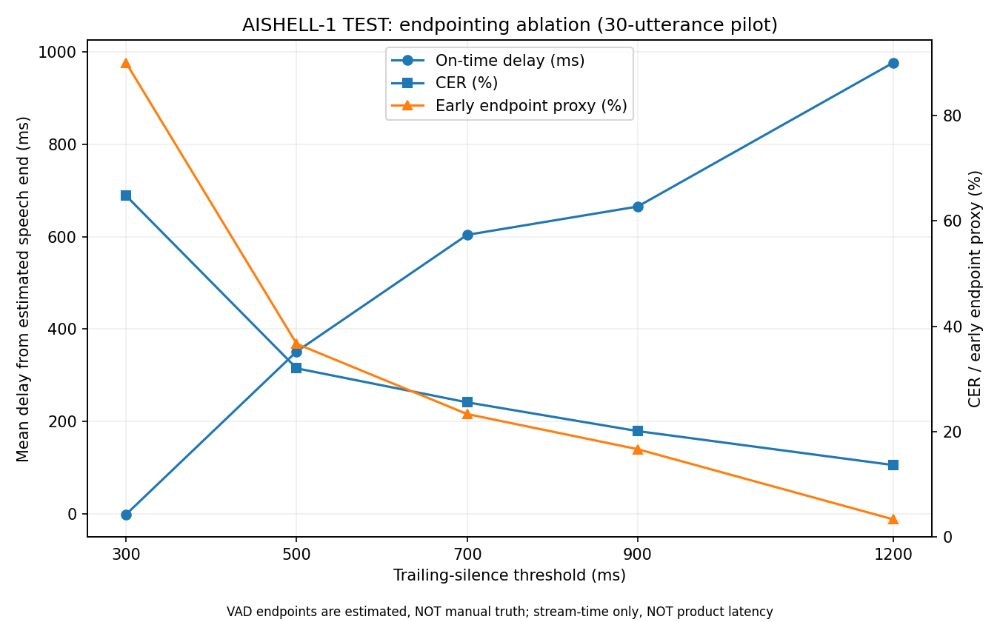
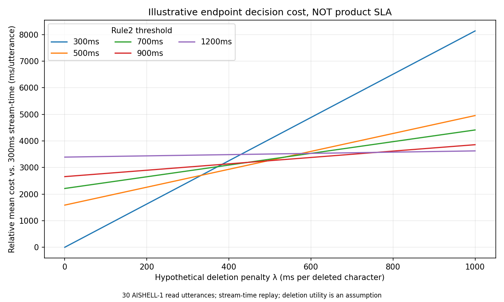
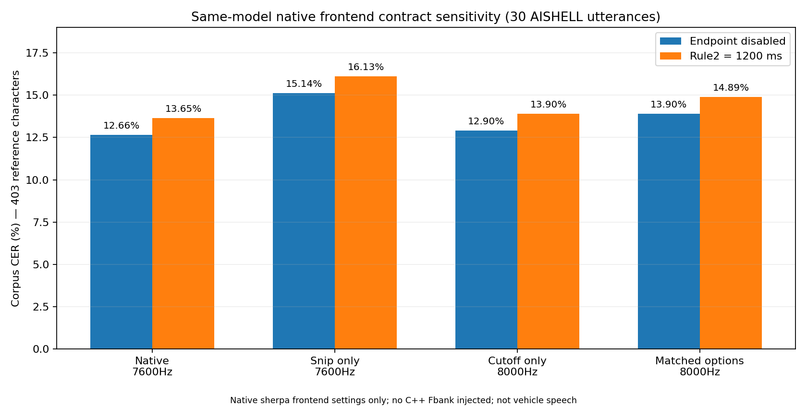

# VoiceFront-End-Bench

**C++17 streaming speech features · Chinese streaming ASR endpoint evaluation · Mandarin TTS text-normalization mini-demo**

A compact, *evidence-first* speech-engineering portfolio. It does not train an ASR model or claim production vehicle-microphone performance. The central engineering question is: **how does an endpoint decision trade earlier finalization against the risk of truncating speech?**

## Visible result — measured, not just a working demo



**Fixed-model sweep:** 30 AISHELL-1 **test** utterances, 11 speakers, 403 reference Chinese characters; same public 14M online Transducer model, 160 ms chunks, two CPU threads, five Rule2 trailing-silence thresholds. Original reference transcripts were cross-checked against AISHELL source text independently of the recognizer.

| Rule2 trailing silence | Corpus CER ↓ | Substitutions | Deletions ↓ | Insertions | Early-endpoint *proxy* |
|---|---:|---:|---:|---:|---:|
| 300 ms | **64.76%** | 17 | **244** | 0 | 27/30 (90.0%) |
| 500 ms | 32.01% | 27 | 101 | 1 | 11/30 (36.7%) |
| 700 ms | 25.56% | 35 | 66 | 2 | 7/30 (23.3%) |
| 900 ms | 20.10% | 43 | 36 | 2 | 5/30 (16.7%) |
| 1200 ms | **13.65%** | 46 | **7** | 2 | 1/30 (3.3%) |

**What improved, and at what cost?** On this *same small dataset*, a more conservative endpoint rule reduced deletions by **237** and corpus CER by **51.12 percentage points** (1200 vs 300 ms). A paired **speaker-cluster bootstrap** (11 speakers, 5,000 resamples) estimated a 95% interval of **−59.10 to −42.55 percentage points** for that CER difference. The cost is waiting longer before finalizing speech. **This is not evidence that 1200 ms is the optimum production threshold.**

**Read the chart carefully:** its delay curve is a mean from **only non-early** events, with the eligible sample count changing from 3 at 300 ms to 29 at 1200 ms. Speech ends come from a reverse-RMS **automatic proxy**, not hand annotation; **28/30** recordings have unclear trailing-silence boundaries. The timing is **unpaced file stream-time, not validated end-user latency**. The early-endpoint rate above is also a *proxy*, not an independently verified false-cutoff rate. Audio is read Mandarin, **not** in-car commands. No AEC, noise suppression, product UX, or CER generalization is claimed.

[**New: paired timing + actual native Fbank contract audit**](docs/ROUND3_VALIDATION_REPORT.md) · [Round 2 one-page summary](docs/ROUND2_SUMMARY.md) · [Full evaluation / per-condition timing and limitations](docs/ROUND2_EVALUATION_REPORT.md) · [Paired uncertainty JSON](results/paired_endpoint_ci.json) · [Individual decoded utterances](results/endpoint_sweep/) · [Data custody](docs/ROUND2_DATASET.md)

## P3 — two decision experiments, not more components

**Product-cost question:** instead of declaring 700ms an intuitive "knee," use a **unit-consistent, explicitly hypothetical** per-utterance cost `mean endpoint stream-time + λ × deletions per utterance`. The lower-envelope winners change at **λ = 332.53, 494.34, 758.87 ms/char**: 300 → 500 → 900 → 1200ms. **700ms is never selected** for this loss on the measured 30 clips. No calibrated business λ or microphone/SLA latency is claimed.



**Frontend-sensitivity question:** a controlled 2×2 ablation in **sherpa's own frontend** showed that matching its `snip_edges` and Mel cutoff **settings** to the C++ configuration changed 9/30 decoded strings and raised Rule2=1200 corpus CER from **13.65% to 14.89%** (+1.24 percentage points) on this exact dataset. A paired 11-speaker cluster-bootstrap interval for that CER change is **[−0.58, +3.26] percentage points**, so generalized degradation is **not established**. This is *native parameter sensitivity*, **not** C++ features fed into ONNX.



[**Full P3 decision report: design, 8 raw ASR runs, cost envelope, re-run commands, limitations**](docs/P3_DECISION_REPORT.md) · [Cost model code](scripts/eval_sla_tradeoff.py) · [Frontend 2×2 runner](scripts/run_frontend_sensitivity.py) · [8-run summary](results/p3_frontend_summary.json)

## Follow-up audits: why this is not just a threshold sweep

**Endpoint timing with no estimated speech-end labels:** paired 700→1200 ms finalization stream-time increased by **1179.2 ms on average** but only **320 ms at the median** (30 matched utterances; source stream-time, **not** microphone/SLA latency). The 500 ms *threshold parameter change* is not equal to a fixed 500 ms observed response delay. [Script](scripts/endpoint_timing_audit.py) · [Methods and intervals](docs/ROUND3_VALIDATION_REPORT.md).

**Fbank contract, using actual sherpa-onnx features:** C++ and Round 2 native frontend settings differ (`snip_edges=true/false`, Mel high cutoff **8000/7600 Hz**). On a shared 559-frame WAV, naive per-index feature MAE was **0.9372**; in an independent **diagnostic** where sherpa settings were matched to the C++ config, feature MAE was **4.58×10⁻⁶**. This demonstrates a **configuration mismatch**, plus close feature agreement after alignment of options. It does **not** prove ONNX Encoder/Decoder equivalence. [Script](scripts/audit_fbank_contract.py) · [Full evidence](docs/ROUND3_VALIDATION_REPORT.md).

## What makes the work technically inspectable?

| Engineering layer | What was actually built or controlled | Where to inspect it |
|---|---|---|
| **DSP / streaming invariants (Round 1)** | Independent C++17 stateful log-Mel Fbank; fixed 16 kHz / 25 ms frames / 10 ms hop / 80 bands; arbitrary chunk sizes; deterministic Release-mode test | [Implementation](src/streaming_fbank.cpp), [streaming tests](tests/test_streaming.cpp) |
| **Numerical root-cause diagnosis (Round 1)** | FFTW-double vs Kaldi-compatible torchaudio float32/float64. Stage-level `.npy` dumps and controlled preprocessing/FFT crossover tests isolate low-energy floating-point sensitivity; *not* bit-exact official Kaldi parity | [Report and numerical tables](docs/EXPERIMENT_REPORT.md), [WSL parity JSON](results/kaldi_parity_wsl.json), [chirp frame 5 trace](results/stage_chirp_f5_b78.json) |
| **Streaming ASR / controlled ablation (Round 2)** | sherpa-onnx online waveform API, fixed model/audio, five thresholds, per-utterance S/D/I and CER, independently checked reference text, speaker-aware paired resampling | [Benchmark runner](scripts/asr_stream_bench.py), [sweep](scripts/run_endpoint_sweep.py), [manifest check](scripts/verify_round2_manifest.py), [metrics](scripts/asr_metrics.py), [bootstrap](scripts/paired_endpoint_ci.py) |
| **Text front-end demonstration (Round 3)** | Standalone rule-based Mandarin text normalization for vehicle messages plus *visual* pause cues; 21 explicit regression examples | [Runnable demo](scripts/tts_tn_demo.py), [tests](tests/test_tts_tn_demo.py) |

**Architecture boundary — do not conflate these pipelines:**

```text
Round 1:  PCM -> custom C++ StreamingFbank -> feature tests / numerical audit
                                  (no ASR connection)

Round 2:  WAV -> sherpa-onnx native waveform frontend -> online Transducer
                                                -> endpoint decision -> CER / stream-time

Round 3:  Mandarin command -> text normalization -> visual pause hints
                                                (no TTS acoustic or vocoder model)
```

The **C++ Fbank does not feed the ASR**; Round 2's CER differences cannot be attributed to the Round 1 frontend. A separate [native-feature audit](docs/ROUND3_VALIDATION_REPORT.md) confirms that the existing two Fbank configurations are **not** directly interchangeable, even though matched feature configurations agree closely. The Rule2 experiment changes the endpoint finalization rule, *not* the model's weights or decoding algorithm. Paired tests, provenance and explicit non-claims matter more here than a single best-looking accuracy number.

## Run locally: no model or dataset download

Python 3.10+ **standard library only** is enough for the Round 3 demo, its regression tests, documentation evidence tests, and the offline paired bootstrap (no model/audio):

```bash
python scripts/tts_tn_demo.py
python scripts/tts_tn_demo.py --text "前方300m右转" --json
python -m unittest discover -s tests -p 'test_tts_tn_demo.py' -v
python -m unittest discover -s tests -p 'test_portfolio_evidence.py' -v
python scripts/paired_endpoint_ci.py --low 300 --high 1200 --reps 5000 --output build/paired_ci_recheck.json
```

The **full** Python test suite also imports NumPy for Round 2 WAV/VAD tests. With NumPy available (e.g. `python -m pip install numpy==2.3.5`), run `python -m unittest discover -s tests -p 'test_*.py' -v`. No ASR model is needed for these unit tests.

Sample output (the `|` separator is a *visual hint*, **not** actual synthesized speech):

```text
Input:      前方300m右转
Normalized: 前方三百米右转
Pause hints: 前方三百米 | 右转
```

Supported demonstration cases include 24-hour clocks, integers 0–9999, up to two decimal places, `m`, `km`, `km/h`, `°C`/`℃`, percentages, and simple punctuation/turn pauses. This is **not** full Chinese TN (phone numbers, dates, IDs, context-specific readings, SSML and acoustic prosody are out of scope). No MOS, TTS naturalness or speech-quality improvement has been measured. The 21 examples are hand-curated regression cases, not held-out corpus accuracy.

The last command recomputes the **published paired CI using committed JSON results**, with no model, WAVs or external dependencies. It writes to ignored `build/` rather than changing the recorded result file.

## Build the C++ frontend (Linux / WSL2)

Requires CMake ≥ 3.16, a C++17 toolchain, FFTW3; for Ubuntu: `sudo apt-get install cmake g++ libfftw3-dev`.

```bash
cmake -S . -B build -DCMAKE_BUILD_TYPE=Release
cmake --build build -j
ctest --test-dir build --output-on-failure
```

For optional numerical parity, install matching CPU PyTorch, torchaudio and NumPy, then:

```bash
python scripts/kaldi_compare.py --binary build/fbank_dump --output build/kaldi_parity_recheck.json
python scripts/stage_diagnostics.py --binary build/fbank_dump --signal chirp --frame 5 --band 78 --output build/stage_chirp_recheck.json --keep-npy-dir build/chirp_trace
```

**Numerical example (WSL2):** chirp frame 5, Mel band 78 had an approximately **0.432394** log-Mel difference against torchaudio float32 but only about **0.000006** against float64 at that band. The pre-log energies remained above the log floor; stage swaps attribute the low-energy discrepancy to float32 window/preprocessing **and** FFT arithmetic, not a floor-triggered error. See [measured WSL2 report](docs/EXPERIMENT_REPORT.md) for full precision/band-specific values and limits. Baseline is not a benchmark of audio quality or ASR correctness.

Verified build environment: Ubuntu 24.04 / WSL2, GCC 13.3, CMake 3.28.3 and FFTW3 3.3.10. Native Windows/MSVC and production real-time allocation behavior have **not** been verified.

## Reproduce Round 2 from source audio (requires downloads)

This full sweep requires a separately downloaded online ASR model, AISHELL test WAVs, packages from [`requirements-round2.txt`](requirements-round2.txt), and access to the upstream Hugging Face mirror. In Ubuntu/WSL, from the repository root:

```bash
python3 -m venv ~/.venvs/voice-r2
~/.venvs/voice-r2/bin/python -m pip install -r requirements-round2.txt
MODEL_ROOT="$HOME/.cache/voice-front-end/models"
mkdir -p "$MODEL_ROOT"
curl -fL "https://github.com/k2-fsa/sherpa-onnx/releases/download/asr-models/sherpa-onnx-streaming-zipformer-zh-14M-2023-02-23.tar.bz2" -o "$MODEL_ROOT/model.tar.bz2"
echo "2cbd71b640d9c37d3784f29367333a4577b0398b62e9deeed418170b081cba8b  $MODEL_ROOT/model.tar.bz2" | sha256sum -c -
tar -xjf "$MODEL_ROOT/model.tar.bz2" -C "$MODEL_ROOT"
MODEL="$MODEL_ROOT/sherpa-onnx-streaming-zipformer-zh-14M-2023-02-23"
~/.venvs/voice-r2/bin/python scripts/fetch_aishell_eval.py --output-root build/round2_reproduced/data --count 30 --seed 20261011 --pages 10
~/.venvs/voice-r2/bin/python scripts/verify_round2_manifest.py --candidate build/round2_reproduced/data/manifest.jsonl
~/.venvs/voice-r2/bin/python scripts/run_endpoint_sweep.py --manifest build/round2_reproduced/data/manifest.jsonl --model-dir "$MODEL" --thresholds 300 500 700 900 1200 --chunk-ms 160 --threads 2 --output-root build/round2_reproduced
~/.venvs/voice-r2/bin/python scripts/paired_endpoint_ci.py --results build/round2_reproduced/endpoint_sweep --low 300 --high 1200 --reps 5000 --output build/round2_reproduced/paired_ci.json
```

**Reproduction caveat:** upstream dataset/mirror contents may change. The commands deliberately write fresh downloads and regenerated results into ignored `build/round2_reproduced/`, leaving committed evidence untouched. The verification command **fails** if the regenerated source IDs, ordered references, source identities or per-WAV SHA-256 values differ from the original [manifest](data/round2_endpoint_eval/manifest.jsonl) (see [provenance](data/round2_endpoint_eval/provenance.json)); do not skip it when claiming exact replication. Raw WAVs and model binaries are **not** in Git. Replayed stream-time depends on pipeline/settings and should not be interpreted as microphone-to-response delay. For a non-download audit, use the already committed sweep JSON and bootstrap command above.

## Interview talking point

**Question:** “What did you optimize?”

**Answer:** “Not the recognizer weights. I evaluated **when** the online system commits a final result. With a fixed model, audio set and chunk size, aggressive 300 ms endpointing deleted 244 characters across 403 reference characters; 1200 ms left 7 deletions, but held finalization longer. I traced the error category, used paired speaker resampling, and explicitly separated estimated endpoint timing from verified user-facing latency. I would not deploy 1200 ms without human end-of-speech labels and paced in-car testing.”

[**Interview grill: decisions, alternatives & falsification tests**](docs/INTERVIEW_GRILL.md) · [P3 quantified decision report](docs/P3_DECISION_REPORT.md) · [Round 2 one-page explanation](docs/ROUND2_SUMMARY.md) · [CV claim/evidence mapping](CV.md) · [Resume-ready bullets with limits](RESUME_BULLETS.md)

## Independent CTC-Decoding-Bench sibling — Rounds 1–3 evaluated

**This is a separate decoder research project**, using an offline 2025 Chinese
Zipformer-CTC model, **not** the streaming Transducer above. The study frozen
and hashed 80 real `[T,1000]` CTC log-probability arrays into a disjoint
**30 Dev / 50 held-out Test** utterance split (not speaker-disjoint).

**Dev, 30 utterances:** A numerically oracle-checked log-domain Prefix Beam
Search and two distinct approximate Blank strategies were examined over 36
conditions. All gave **2.94% corpus CER** (13 edits / 442 reference characters),
matching independent Framewise Greedy. Beam 16 Hard Skip θ=.90 bypassed 80.4%
of frames and ran **3.68× faster than unpruned Beam 16** in decoder-only Python,
but changed 2/30 transcripts; equal aggregate CER did not mean losslessness.

**Pre-registered held-out Test, 50 utterances:** One evaluation of four locked
conditions (Greedy, Beam 16 unpruned, Beam 16 Forced Blank θ=.95, Beam 4 Forced
Blank θ=.95) produced **1.6461% corpus CER for all four (S/D/I=11/0/1,
12 edits / 729 reference characters)**. All **50/50 token sequences matched**;
no UTF-8 replacement characters occurred on this Test. Mean decoder-only
per-utterance medians were **0.0264 / 15.5411 / 5.1219 / 3.2940 ms**, respectively.
Thus Greedy was the **sole Test CER–decoder-time Pareto choice**, and unpruned
Beam 16 cost ~**589×** its decoder time without accuracy improvement. A
separate 200-hypothesis audit returned **PASS**. Three deterministic bad cases
have text/logit triage; manual audio attribution remains open.

These are local Python decoder-only results with no external LM. No lossless
pruning, training-overlap independence, speaker-disjoint robustness, universal
Greedy advantage, end-to-end latency or production performance is claimed.

[**Round 1 contract**](docs/CTC_ROUND1_STATUS.md) ·
[**Round 2 Dev experiment**](docs/CTC_ROUND2_STATUS.md) ·
[**Round 3 locked protocol**](docs/CTC_ROUND3_PROTOCOL.md) ·
[**Round 3 held-out results and limitations**](docs/CTC_ROUND3_STATUS.md) ·
[Test JSON](results/ctc_test_final_results.json) ·
[Test CSV](results/ctc_test_final_results.csv) ·
[Test Pareto figure](results/ctc_test_pareto.png) ·
[CTC CV evidence](CV.md)

## Original VoiceFront-End-Bench closure & scope

**The original Round 3 / P3 is CLOSED as a locally validated engineering portfolio**
(34 Python tests and 1 C++ CTest at its original closure, *not* a production
speech assistant). The definitive acceptance criteria, measured experiment
results and limitations are recorded in
[Round 3 Closure Record](docs/ROUND3_CLOSURE.md). With the independent CTC
Rounds 1–3 study included, the Python suite passed **74/74 tests** in the
Round 3 WSL2 closure validation. See [CTC Round 3 status](docs/CTC_ROUND3_STATUS.md)
for the one-shot held-out Test evidence. No remote push or release tag is implied.

## Boundaries & license

Round 2 R2-A/R2-B are **closed as a controlled exploratory evaluation**, not a validated in-car optimization; optional WebRTC NS ablation R2-C was deferred. Round 3 TN demo is a **rule demonstration only**, not synthesized speech. No AEC3, neural suppression, speaker-independent deployment claim, custom ASR training, or measured TTS quality improvement. Additional DSP lab material is **not included in this checkout**; external links should only be added when their files/URLs can be verified.

FFTW3 is dynamically linked, not bundled, and has separate GPL licensing terms. Assess redistribution obligations before packaging linked binaries. **This checkout does not yet include a first-party LICENSE file**, so it should not be represented as an already-licensed open-source release. No release tag or remote push is part of this local Round 3 change.
