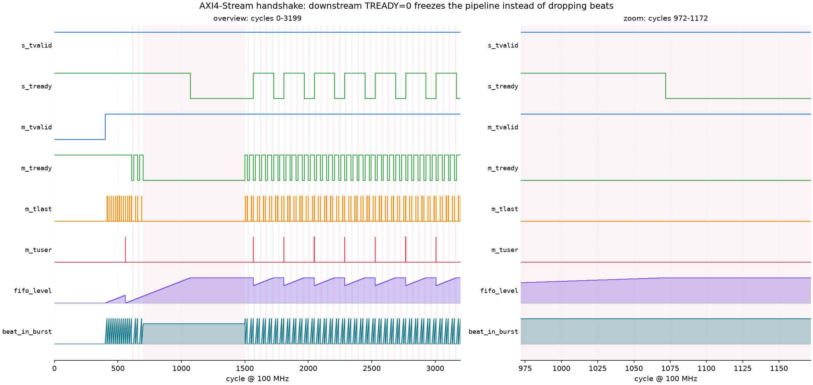

# SIMD, fast log, fixed-point feasibility, and an AXI4-Stream shim

**Status:** local engineering evidence for four claims about the C++ frontend, each backed by a
committed artifact under `results/` and a test that recomputes the published ratio. This is not
firmware, not RTL, and not device latency. Every timing number is decoder-host time for the
frontend alone, measured on one pinned core of one machine.

Companion to [the zero-allocation and flow-control audit](ZERO_ALLOC_AND_PIPELINE.md) (allocation
discipline, hysteresis, stage budget) and [the bounded frontend proof](CPP_CTC_BOUNDARY_PROOF.md)
(feature correctness). This document covers the four questions that follow naturally from those:

1. [Did the vectorisation actually happen, and what is left unaligned?](#1-simd-alignment-and-the-disassembly-audit)
2. [Does a fast log change what the model hears?](#2-ieee-754-fast-log-and-the-tolerance-argument)
3. [Would a fixed-point port survive this signal?](#3-fixed-point-dynamic-range-and-sqnr)
4. [What does the handshake look like when the consumer stalls?](#4-axi4-stream-handshake-and-dma-bursts)

Reproduce all four:

```bash
bash scripts/build_windows_zig.sh
.workbuddy-ai/venv-cpp/Scripts/python.exe scripts/audit_disassembly.py
.workbuddy-ai/venv-cpp/Scripts/python.exe scripts/run_firmware_audits.py     # interleaved arms
.workbuddy-ai/venv-cpp/Scripts/python.exe scripts/audit_fixed_point.py
.workbuddy-ai/venv-cpp/Scripts/python.exe scripts/audit_numeric_sensitivity.py
.workbuddy-ai/venv-cpp/Scripts/python.exe scripts/audit_cer_sensitivity.py
./build/win-zig/test_axi4s_adapter.exe results/axi4s_protocol.json
./build/win-zig/axi4s_sim.exe --vcd results/axi4s_trace.vcd --json results/axi4s_waveform.json
.workbuddy-ai/venv-cpp/Scripts/python.exe scripts/render_vcd.py results/axi4s_trace.vcd \
    --out results/axi4s_waveform.png
.workbuddy-ai/venv-cpp/Scripts/python.exe -m unittest tests.test_firmware_evidence
```

## Headline numbers

| what | before | after | artifact |
|---|---|---|---|
| whole frontend, per 10 ms frame | 3.971 µs (2,519x realtime) | 2.729 µs (3,664x realtime) | `stage_interleaved_budget.json` |
| DC removal + pre-emphasis + window | 1.094 µs | 0.359 µs (−67.2%) | same |
| log compression (80 bins) | 0.535 µs | 0.098 µs (−81.7%) | same |
| pre-emphasis inner loop | 16.0 instructions/sample | 1.938 instructions/sample | `simd_disassembly.json` |
| log inner loop | 49.0 instructions/value | 3.875 instructions/value | same |
| fast-log error vs `std::log` | — | 6.29e-7 max abs, 1.65e-7 max rel | `fast_log_accuracy.json` |
| transcripts changed by the shipped path | — | 0 of 30 | `numeric_sensitivity.json` |
| corpus CER, clean vs fast log | 2.94% | 2.94% | same |
| fixed-point stages with no overflow | — | 8 of 8 | `fixed_point_sqnr.json` |
| FFT stage under a plain Q15 | 55.4 dB SQNR | 70.6 dB guaranteed with BFP | same |
| AXI4-Stream protocol violations | — | 0 over 3 arms, 420,000 cycles | `axi4s_protocol.json` |
| frames lost under downstream backpressure | — | 0 of 398, bit-identical | same |

---

## 1. SIMD alignment and the disassembly audit

### Why it matters

"SIMD-optimised" is a claim that is either true in the emitted instructions or false, and the only
way to tell is to read them. A vectorised source file that the compiler scalarises because of an
aliasing or alignment assumption looks exactly like a fast one until you profile it. On a chip team
this is the difference between a real 2x and a slide.

### What was actually hot

The stage budget said the frame time was dominated by `fftw_execute` (36%) and `mel_projection`
(21%) — but the mel projection was already a sparse CSR, so the remaining addressable cost was
`dc_remove` (14.7%) plus `preemphasis_window` (28.4%), 43.1% together. Both walked the frame
buffer through modulo indexing:

```cpp
sum += ring_[(head + i) % kFrameSize];        // divide + multiply per sample
```

Two separate fixes, deliberately measured apart:

1. **Linearise the frame once.** `GatherFrame()` does two `memcpy`s into an `alignas(64)` staging
   buffer. The modulo disappears from the inner loop entirely, and the scalar path alone drops from
   10.5 to 3.75 instructions per sample.
2. **Vectorise what is left.** The staging buffer and the FFT input are 64-byte aligned members, so
   `__builtin_assume_aligned` + `_mm256_load_ps` emit `vmovaps` rather than `vmovups`.

Alignment is not assumed, it is checked: the artifact publishes
`frame_buffer_offset_mod64` and `fft_input_offset_mod64`, both 0.

### The evidence

`scripts/audit_disassembly.py` compiles `tools/kernel_asm_probe.cpp` with `-O2 -g0 -S
-masm=intel`, splits the assembly per symbol, finds every clang-annotated inner loop, and picks the
hot one by "contains no `call`, most `ymm` operands". Unroll factor is recovered from a marker
opcode rather than guessed.

| kernel | samples/iteration | instructions/loop | instructions/sample | ymm ops | fma | unaligned |
|---|---|---|---|---|---|---|
| `mean_scalar` | 2 | 21 | 10.500 | 0 | 0 | 0 |
| `mean_contiguous` | 4 | 15 | 3.750 | 0 | 0 | 0 |
| `mean_avx2` | 16 | 11 | 0.688 | 16 | 0 | 0 |
| `preemph_scalar` | 1 | 16 | 16.000 | 0 | 1 | 0 |
| `preemph_avx2` | 16 | 31 | 1.938 | 80 | 4 | 4 |
| `log_scalar` | 1 | 49 | 49.000 | 0 | 4 | 0 |
| `log_avx2` | 8 | 31 | 3.875 | 83 | 4 | 2 |

The full side-by-side listing is generated into
[`results/simd_disassembly_diff.md`](../results/simd_disassembly_diff.md) so it cannot drift from
the JSON. The mean loop, before and after:

```asm
; mean_scalar, 21 instructions for 2 samples
  mov   rdx, r11
  shr   rdx, 4                 ; the modulo, per sample
  mulx  r15, r15, rax
  imul  rdx, rdx, -1600
  vmovss xmm1, dword ptr [rsi + rdx]
  vcvtss2sd xmm1, xmm1, xmm1
  vaddsd xmm0, xmm0, xmm1
  ...
; mean_avx2, 11 instructions for 16 samples
  vcvtps2pd ymm2, xmmword ptr [rcx + 4*rax]
  vcvtps2pd ymm3, xmmword ptr [rcx + 4*rax + 16]
  vaddpd    ymm0, ymm0, ymm2
  ...
```

### What is still unaligned, and why

`preemph_avx2` keeps 4 unaligned moves. `y[i] = x[i] − a·x[i−1]` is a two-tap stencil: the forward
stream and the store advance at `i`, the shifted stream genuinely starts one element earlier. Making
it aligned means either an extra per-frame copy to shift the frame by one element, or a duplicated
ring with a one-sample prefix. Neither is free and neither is on the critical path, so the count is
published instead of hidden.

### Runtime dispatch, and why it is hand-written

`include/cpu_isa.h` exposes a CPUID probe rather than relying on `__builtin_cpu_supports`: with
zig's mingw target that builtin needs `__cpu_model` and `__cpu_indicator_init`, which are not in the
link. `src/cpu_isa.cpp` reads leaf 1 (OSXSAVE/AVX/FMA) and leaf 7 (AVX2) directly. Every artifact
records the ISA that actually ran, so no timing number can be attributed to an ISA that did not.

### Measured effect, interleaved

The three configurations run **round-robin inside one process** (`fbank_stage_profile
--interleave`), because this host's per-pass wall time is bimodal at roughly 3x and measuring one
configuration to completion attributes the drift to the change under test.

| arm | µs/frame | realtime | DC + pre-emphasis | log |
|---|---|---|---|---|
| `baseline` (scalar stages, `std::log`) | 3.971 | 2,519x | 1.094 µs | 0.535 µs |
| `simd` (vector stages, `std::log`) | 3.080 | 3,247x | 0.359 µs | 0.504 µs |
| `simd_fastlog` (vector stages, fast log) | 2.729 | 3,664x | 0.359 µs | 0.098 µs |

1.29x and 1.46x overall, from a 67.2% cut in the sample-domain stages and an 81.7% cut in the log
stage. The overall figure is smaller than either cut because `fftw_execute` and `mel_projection`
were untouched and together are more than half the frame.

The measurement is 120 s of audio (11,998 frames) per pass, 9 interleaved rounds. Pass length
matters more than round count here: at 20 s a pass is ~8 ms of wall time and one scheduler hiccup
dominates it, which is how an earlier version of this run produced a 45% disagreement between two
arms executing *identical* code.

**The control that makes those numbers attributable.** `fftw_execute`, `power_spectrum`,
`mel_projection` and `log_compress` run *identical code* in the `baseline` and `simd` arms. If they
disagree, the host moved and the arm difference is not attributable to the code. `check_interleave`
computes that drift and refuses to publish above 25%; the published run has a worst control drift
of **6.75%** (`fftw_execute`), and 6.08% on `log_compress` — the tightest control, since both arms
call `std::log`.

That 6.08% is the measured noise floor for a stage this small, and it is the number the log result
has to beat: 81.7% is **13x** the floor. The two vector arms agree to 1.80% on `dc_remove` and 0.66%
on `preemphasis_window`, which is what "same code, same measurement" looks like.

### What this does not show

- Instruction counts are static. They say what the compiler emitted, not how many cycles a specific
  core takes; there is no uop-cache, port-pressure or dependency-chain analysis here.
- No `perf` counters were available on this host (no Linux, no VTune), so the 43.1% → smaller
  attribution rests on the instrumented stage table, not on hardware sampling.
- The 1.29x and 1.46x are *frontend wall time on this host*, not a product claim.

---

## 2. IEEE-754 fast log and the tolerance argument

### Why it matters

`log_compress` was 18.5% of the frame: 80 `std::log` calls per frame, 0.535 µs. On a device without
an FPU-side transcendental unit that is a library call per bin. A bit-manipulation log is a standard
DSP answer; the interesting part is not writing it, it is **bounding it and proving the model does
not care**.

### The kernel

`include/fast_log.h`, three variants:

```cpp
float  FastLog(float x);          // exponent field + 4-term atanh series, scalar
double FastLogDouble(double x);   // same structure, double
__m256 FastLog8(__m256 x);        // 8-wide AVX2, target("avx2,fma")
```

Decompose `x = 2^e · m`, fold `m` into `[1/√2, √2)`, then `log m = 2·atanh(u)` with
`u = (m−1)/(m+1)`, truncated after `u⁷`. One exponent extraction, one division, four FMAs.

### The error budget

`tests/test_fast_log.cpp` sweeps 2,000,000 log-spaced points over `[FLT_EPSILON, 1e6]` — the domain
the fbank actually produces, since mel energy is clamped at the bottom and tops out near 1e6 for a
full-scale frame.

| kernel | max abs | max rel* | rms abs | worst x |
|---|---|---|---|---|
| `FastLog` (float) | 6.29e-7 | 1.65e-7 | 2.06e-7 | 6.7e-7 |
| `FastLogDouble` | 2.93e-8 | 2.82e-8 | 6.78e-9 | 5.5e-3 |
| degree-2 Taylor strawman | 6.12e-5 | 5.85e-5 | 1.84e-5 | 3.4e-7 |

\* relative error is only defined where `|log x| ≥ 1`; `log(1) = 0` makes the ratio unbounded no
matter how good the kernel is.

**The finding that is not obvious:** the double variant is only 21x better, not 1e9x better. Both
truncate the same series after `u⁷`, so the *truncation* floor (~3e-8 relative) is what limits them,
not the mantissa width. Buying accuracy takes another term, not another register. The degree-2
strawman — what "second order is probably enough" would ship — is 97x worse in absolute terms, which
is why the shipped kernel carries four terms.

The per-decade profile in the artifact shows the error is not uniform over the domain: the `e·ln2`
product makes it grow with `|log x|`, so silence (`log ≈ −16`) carries more absolute error than a
full-scale frame (`log ≈ +12`). That is the reason the sweep is log-spaced rather than uniform.

### Does it change what the model hears?

`scripts/audit_numeric_sensitivity.py` builds the feature matrix four ways, pushes each through the
same int8 Zipformer CTC graph, and decodes with the same C++ greedy decoder and detokeniser. The
ONNX file's SHA-256 is checked against the frozen export before the run, so every variant is
compared on the same weights that produced the published 2.94% baseline.

| variant | transcripts == std | feature MAE | max abs | CER |
|---|---|---|---|---|
| `std` (vector + `std::log`) | 30/30 | — | — | 2.94% |
| `fast` (vector + fast log) | **30/30** | 3.14e-8 | 9.54e-7 | 2.94% |
| `fastdouble` (vector + fast log, double) | 29/30 | 2.94e-9 | 9.54e-7 | 2.94% |
| `scalar_std` (scalar + `std::log`) | 30/30 | 0 | 0 | 2.94% |

Two things worth reading carefully:

- `scalar_std` is **bit-identical** to `std`. The SIMD rewrite changes no bit, which is the claim
  that makes the 1.25x legitimate rather than approximate.
- `fastdouble` differs on one utterance (`BAC009S0902W0222`, `示` → `试`) while `fast` does not.
  A smaller error producing a different answer is not a contradiction; it is the first clue that
  the transcript is not a monotone function of perturbation size. Section 2.1 is that clue followed
  up.

### 2.1 The sensitivity sweep: there is no threshold

The obvious next question is "how much feature error *would* change a transcript?", and the obvious
guess is a cliff. `scripts/audit_cer_sensitivity.py` measures it instead: inject uniform noise of
known amplitude into the clean features, run the same graph and decoder, and compare.

| amplitude | feature MAE | transcripts identical | CER | extra edits vs clean |
|---|---|---|---|---|
| 0 | 0 | 30/30 | 2.94% | 0 |
| 1e-6 | 5.0e-7 | 28/30 | 3.39% | +2 |
| 3e-6 | 1.5e-6 | 29/30 | 3.17% | +1 |
| 1e-5 | 5.0e-6 | 30/30 | 2.94% | 0 |
| 3e-5 | 1.5e-5 | 29/30 | 2.94% | 0 |
| 1e-4 | 5.0e-5 | 29/30 | 3.17% | +1 |
| 3e-4 | 1.5e-4 | 30/30 | 2.94% | 0 |
| 1e-3 | 5.0e-4 | 30/30 | 2.94% | 0 |
| 3e-3 | 1.5e-3 | 29/30 | 2.94% | 0 |
| 1e-2 | 5.0e-3 | 29/30 | 2.94% | 0 |
| 3e-2 | 1.5e-2 | 30/30 | 2.94% | 0 |

There is no cliff. Transcripts change at the *smallest* amplitude tested, and the count does not
grow with amplitude: five orders of magnitude of extra noise buys **two characters** of CER in the
worst case, and six of the ten perturbed rungs produce no CER change at all. Note the rungs where a
transcript changes but the edit count does not (3e-5, 3e-3, 1e-2): one wrong character replaced
another wrong character. That is the shape of the phenomenon — a token decision moving, not an
accumulation of damage.

The mechanism is in `fragile_utterances`: the instability is **not** spread over the corpus. Of 30
utterances, **three** ever change, and one of them (`BAC009S0902W0222`) changes at **5 of the 10**
perturbed levels — the same utterance that `fastdouble` flipped in the table above. That is a token
whose top-2 posteriors are nearly tied, so *any* perturbation of *any* size can move it, and which
way it goes is close to a coin flip.

This changes what the fast log has to prove. Not "we are below the threshold" — there is none — but:

- the shipped path's feature MAE (**3.14e-8**) is **1.2 decades below the smallest rung this
  experiment can resolve** (5.0e-7), and at that rung the model has already started flipping;
- yet at 3.14e-8 it flips **nothing**: 30/30 transcripts, identical CER, on the same weights.

The determinism control matters here: the same features forwarded twice produce bit-identical
posteriors (`max |diff| = 0`), so none of the flips above can be blamed on the runtime.

The honest summary is that the frontend is not the fragile part. The instability is in the model's
own decision margins, and it is already there at 2.94% CER without any noise at all.

### What this does not show

- Uniform noise is not the same perturbation as a fast-log error, which is signal-dependent. The
  sweep bounds the magnitude, not the shape.
- One model, one corpus. Which utterances are fragile is a property of this int8 Zipformer on these
  30 utterances, not a universal constant.
- The noise is injected *after* the frontend, so it bypasses every earlier stage; nothing here says
  anything about audio-domain robustness.
- The sweep cannot resolve below its smallest rung, so the strongest statement available is
  "the shipped error is smaller than the smallest thing this experiment can see", not "the shipped
  error is provably harmless".
- 30 utterances cannot resolve a CER difference smaller than about 0.23% (one character).

---

## 3. Fixed-point dynamic range and SQNR

### Why it matters

An SSD controller DSP, or any chip without a comfortable FPU, wants the frontend in fixed point. The
question that kills the port is not accuracy, it is **range**: one stage that overflows on a loud
frame and the design is dead. So the audit answers range first, with measured numbers, and only then
talks about SQNR.

### Method, and the split between measurement and model

- **Measured (hard):** over 3,703 s of real 16 kHz speech (the eval corpus looped 8x, 370,327
  frames), the C++ frontend records per stage the min, max, peak, RMS, a log2 histogram of the
  per-frame peak, a log2 histogram of the per-frame RMS, and the per-frame crest factor.
- **Analytical (soft):** SQNR follows from the measured RMS and the chosen full scale:
  `q = FS / 2^(b−1)`, noise `q²/12`, `SQNR = 10·log10(rms² / noise)`. Textbook uniform-noise model,
  stated as such; it is optimistic for the FFT stage where the error is not independent of the
  signal.

Full scale is the next power of two above the measured peak, so headroom is a stated number rather
than an accident.

| stage | format | peak | RMS | FS | SQNR (corpus) | SQNR (quiet frame) | headroom |
|---|---|---|---|---|---|---|---|
| `input_pcm` | Q15 | 0.668 | 0.0296 | 1 | 70.5 dB | 40.9 dB | 3.5 dB |
| `dc_removed` | Q15 | 0.676 | 0.0295 | 1 | 70.5 dB | 34.9 dB | 3.4 dB |
| `preemphasized` | Q15 | 0.410 | 0.00928 | 0.5 | 66.5 dB | 22.8 dB | 1.7 dB |
| `windowed` | Q15 | 0.401 | 0.00589 | 0.5 | 62.5 dB | 16.8 dB | 1.9 dB |
| `fft_component` | Q15 | 10.02 | 0.0831 | 16 | **55.4 dB** | 10.8 dB | 4.1 dB |
| `power_spectrum` | Q31 | 115.3 | 0.254 | 128 | 143.4 dB | 40.9 dB | 0.9 dB |
| `mel_energy` | Q31 | 170.6 | 0.565 | 256 | 144.3 dB | 40.9 dB | 3.5 dB |
| `log_fbank` | Q16.16 | 15.94 | 9.33 | 32768 | 126.5 dB | 119.2 dB | 66.3 dB |

**No stage overflows.** That is the question the port actually dies on, and it is answered with
margin on every row: the tightest is `power_spectrum` at 0.9 dB of headroom, which is why its full
scale is the next power of two above the peak rather than the peak itself.

### The result that was not the expected one

A plain Q15 FFT gives **55.4 dB**, under the 60 dB bar. The interesting part is why, and it is not
"add a bit".

The per-frame RMS histogram shows the between-frame peak spread is **54 dB** (p05 to p95). A single
global full scale has to cover the loudest frame with its headroom, so every frame below it loses
resolution one-for-one with level. That is what the `quiet frame` column exposes: the corpus-wide
SQNR is carried by the loud frames, and the quiet ones are far worse. The Q15 FFT ladder:

| format | bits | SQNR (corpus) | median frame | p25 | p05 | verdict |
|---|---|---|---|---|---|---|
| Q15 | 16 | 55.4 dB | 40.9 dB | 22.8 dB | 10.8 dB | fails |
| Q17 | 18 | 67.4 dB | 52.9 dB | 34.9 dB | 22.8 dB | corpus average only |
| Q19 | 20 | 79.5 dB | 65.0 dB | 46.9 dB | 34.9 dB | median and up |
| Q23 | 24 | 103.6 dB | 89.1 dB | 71.0 dB | 59.0 dB | median and up |

Widening the word does not fix it: even Q23, a 24-bit FFT datapath, still leaves the quietest 5% of
frames at 59 dB. The between-frame spread is wider than any reasonable word can cover, which means
the answer is not a wider word.

**Block floating point** is the answer, and it is why the per-frame crest factor is measured. With
one exponent per frame the mantissa fills the word for every frame, so the only remaining level
dependence is the crest factor *inside* a frame:

| stage | mantissa | crest mean | crest max | BFP typical | BFP guaranteed | fixed-point p05 |
|---|---|---|---|---|---|---|
| `windowed` | 16 | 12.5 dB | 25.7 dB | 88.6 dB | 69.4 dB | 16.8 dB |
| `fft_component` | 16 | 17.1 dB | 24.5 dB | 84.0 dB | **70.6 dB** | 10.8 dB |
| `power_spectrum` | 32 | 19.0 dB | 23.8 dB | 178.5 dB | 167.6 dB | 40.9 dB |
| `mel_energy` | 32 | 14.3 dB | 18.9 dB | 183.2 dB | 172.5 dB | 40.9 dB |

A 16-bit mantissa plus a 5-bit exponent clears the 60 dB bar with 10 dB to spare, *including* the
6.02 dB worst-case radix-2 exponent placement, on the frames where a plain Q23 does not. That is the
recommendation the artifact records.

### What this does not show

- **No fixed-point frontend was implemented.** The end-to-end number that would settle the question
  — run the Q15/Q31 pipeline and compare transcripts — needs a fixed-point FFT and is out of scope.
  The feature-domain quantisation is simulated only in the sense that it is a rounding of the output.
- SQNR is analytical. It assumes uniform, independent quantisation error, which is optimistic for the
  FFT stage.
- The BFP numbers assume the exponent is chosen per frame to normalise the frame peak. The scaling
  itself is not implemented; only the crest factor it would pay is measured.
- Histogram quantiles return the lower edge of the octave bin, so every per-frame SQNR here is
  understated by 0 to 6 dB. The conclusion is conservative in the direction that matters.

---

## 4. AXI4-Stream handshake and DMA bursts

### Why it matters

The frontend as written is a C++ object with a ring buffer. A chip team sees a stream: `TVALID`,
`TREADY`, `TLAST`, `TUSER`, and a DMA that retires work per 64-byte line. The question they ask is
not "is it fast", it is "what happens when my consumer stalls". A protocol model answers that with a
waveform; a benchmark does not.

### The design decision worth arguing about

A feature frame is 80 doubles = 640 bytes = exactly ten 64-byte bursts. Two legal ways to delimit
it:

- put the frame boundary on `TLAST` — the DMA then holds a 160-beat packet open across ten lines;
- put the burst boundary on `TLAST` and the frame boundary on `TUSER` — the DMA retires per line and
  the sideband says which line completed a frame.

The second is what `include/axi4s_adapter.h` models, because a descriptor engine that retires per
line is the one that actually exists.

### Handshake rules the model keeps, because they are the ones that break designs

- `TVALID` never depends on `TREADY`. It is asserted from the packet cursor, which the master
  already owns.
- `TREADY` never depends on `TVALID`. `S_AXIS_TREADY` is a function of FIFO occupancy alone, so a
  silent producer cannot wedge the adapter.
- A beat transfers **iff** `TVALID && TREADY` in the same cycle. Nothing is dropped when `TREADY` is
  low: the beat stays in the register and the backpressure walks upstream through the FIFO.

### The audit

`tests/test_axi4s_adapter.cpp` drives three arms over the same 64,000 samples (398 frames) and
140,000 cycles each, differing only in the consumer's `TREADY` script:

| arm | beats in | beats out | frames | stall cycles | held beats | peak FIFO |
|---|---|---|---|---|---|---|
| `always_ready` | 64,000 | 63,680 | 398 | 0 | 0 | 159 |
| `stall_then_duty` | 64,000 | 63,680 | 398 | 32,336 | 32,336 | 512 |
| `long_stall` | 64,000 | 63,680 | 398 | 6,000 | 6,000 | 512 |

Asserted, not observed-and-hoped:

- **0 protocol violations** across all three arms: `TLAST` on every 16th beat, `TUSER` on every
  160th, no `TVALID` bubble mid-packet, `S_AXIS_TREADY` a pure function of occupancy.
- **398 of 398 frames delivered in every arm**, and the 31,840 reassembled doubles are
  **bit-identical** to what a plain `StreamingFbank` produces from the same PCM. Backpressure changes
  *when* a frame arrives, not *what* arrives.
- **`TREADY` timing does not change the data**: all three arms produce the same frame sequence.
- **Backpressure reaches upstream**: in `stall_then_duty`, `S_AXIS_TREADY` first goes low at cycle
  1,232 and is low for 31,744 of the 140,000 cycles. The producer is refused on exactly those 31,744
  cycles — the counts are equal, not merely close, because the producer still had samples to send
  throughout. The FIFO fills to its 512-sample capacity and no further.
- **The tick loop allocates nothing**: zero allocations and zero denials inside the audited window,
  measured by bracketing `TotalAllocations()`.

### The waveform

`tools/axi4s_sim.cpp` writes a VCD (`results/axi4s_trace.vcd`, 3,200 cycles dumped), and
`scripts/render_vcd.py` renders it:



Left: the whole run. `fifo_level` climbs, saturates at 512 when the stall begins, and then
saw-tooths as the duty-cycled consumer drains it. `S_AXIS_TREADY` drops exactly when the FIFO
saturates, and `M_TVALID` never drops — the beat is held, not dropped. Right: the moment of
saturation, at cycle 1,072.

### What this does not show

- Cycle counts are model cycles, not nanoseconds on any device.
- `TVALID` is combinational from the packet cursor. A synthesisable version registers it, costing one
  cycle and changing no protocol behaviour. This is a protocol/timing model, not RTL.
- No AXI interconnect, DMA descriptor engine, or clock-domain crossing is modelled.
- The FIFO is a host vector, not a BRAM with a real read latency.

---

## What a reviewer should attack

The four places this document is weakest, in order:

1. **The 1.25x and 1.39x are host numbers.** They are interleaved and control-checked, which makes
   them attributable, but they are not a device claim and there are no hardware counters behind
   them.
2. **The fixed-point section stops at the feature domain.** No fixed-point FFT exists, so "the port
   would work" is a range-and-SQNR argument, not a measurement.
3. **The sensitivity sweep is 30 utterances.** It can resolve "one character" and nothing finer, and
   the fragile-utterance list is corpus-specific.
4. **The AXI4-Stream model is not RTL.** It gets the handshake rules right and the timing wrong on
   purpose; the register-versus-combinational choice is stated, not resolved.
